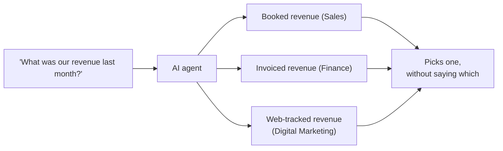
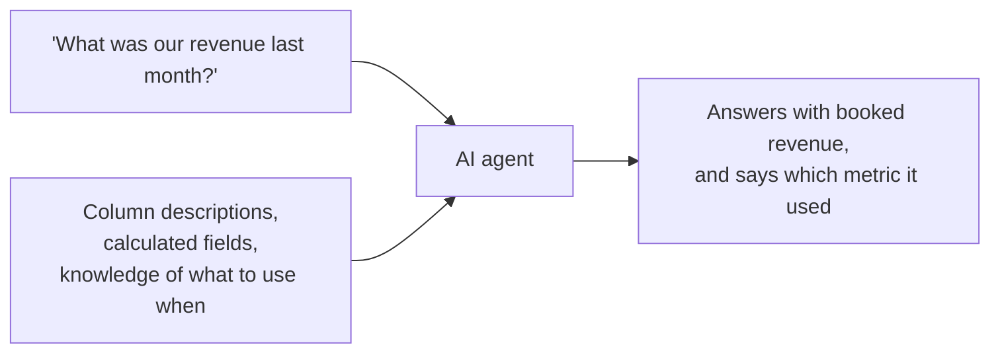
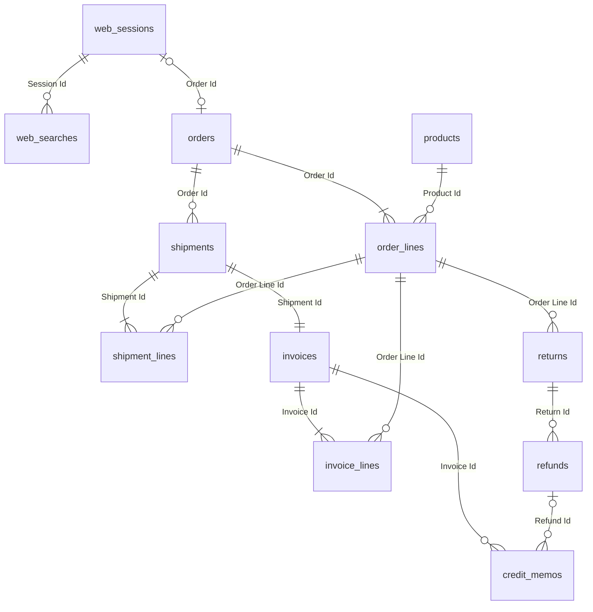
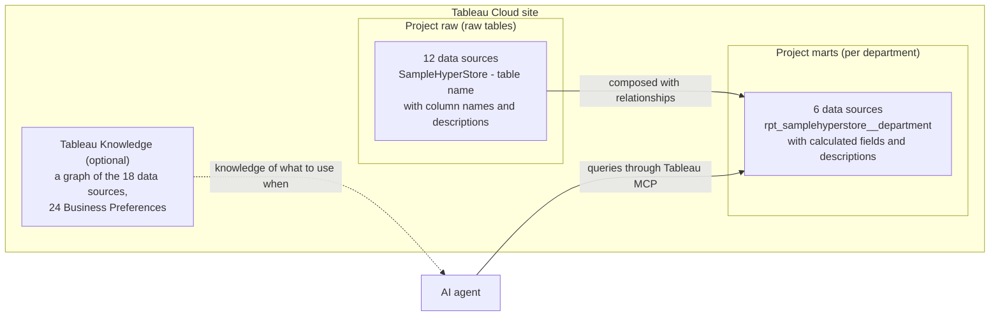

# SampleHyperStore

Sample data for testing whether an AI agent connected through Tableau MCP answers business questions with the right metric. It holds three years of transactions of a fictional US retailer, generated with Claude Code. Every company, person and number in it is fictional.

**[See what you can analyze →](https://yoshitakaarakawa.github.io/SampleHyperStore/?lang=en)** A one-page tour of what the dataset holds besides the 12 tables, an analysis that digs across them, how business rules change an AI agent's answer, and example questions for a demo.

## Why this dataset

Tableau's classic sample data, Superstore, is one table with sales and profit columns already in place. Real business data is not like that. It is split across systems, the same word means different things in different departments, and the metrics have to be defined by the business.

Connect an AI agent to data like that as it is, and the agent cannot tell which metric to use. Ask "What was our revenue last month?" and this happens:

Once the data is described and the meaning of each metric is defined, the agent can pick the metric that fits the question. SampleHyperStore provides three things for that:

| What is added | What it holds | Example |
|---|---|---|
| Column descriptions | What each column means | `Qty Cancelled`: units cancelled before shipment |
| Calculated fields | Each department's metrics, with formulas and descriptions | Sales' `Revenue`: booked revenue net of cancellations, by order date |
| Business Preferences (Tableau Knowledge) | The default meaning of words, and when to use which metric | Unqualified "revenue" means booked revenue; questions about fiscal periods or returns use invoiced revenue |

With SampleHyperStore you can compare the raw state and the described state on the same data.

## Where AI agents trip up

The data contains situations that AI agents tend to get wrong, on purpose. Each is meant to be solved by the descriptions, calculated fields and Business Preferences that the setup adds.

| Where agents trip up | What is in the data | What solves it |
|---|---|---|
| Mixing up metrics with the same name | "Revenue" exists in three versions, one per department | Each department's `Revenue` calculated field, and the Business Preference "Default meaning of sales and revenue" |
| Not choosing among several definitions | Return rate has several definitions by department: requested, received, order cohort | Business Preferences with the formula of each definition, the Business Preference "Terms departments use for different metrics", and the Business Preference "Which to use: Return rate" |
| Confusing calendar and fiscal years | The fiscal year starts in February | The description of `Fiscal Month`, and the Business Preference "Fiscal periods for Finance questions" |
| Missing a change over time | Sales regions were realigned in January 2025 | The `Sales Region (Current Map)` calculated field, and the Business Preference "Sales region realignment on 2025-01-01" that says when to use it |
| Failing to build a metric across data sources | Return rate and net shipping cost take their numerator and denominator from different data sources | Business Preferences that name where each part comes from |

The questions are in [`docs/questions.md`](docs/questions.md). There are two ways to compare. One is to show the agent only the raw-table data sources and ask. The other is to add the data sources with defined metrics and the Tableau Knowledge settings, and ask the same questions again.

## What is inside

| Location | Contents |
|---|---|
| `csv/in_use/` | The 12 tables the Tableau setup uses |
| `csv/planned/` | 12 more tables, not used yet (kept for future extensions) |
| `docs/data_dictionary.md` | Tables, grains, keys and columns |
| `docs/questions.md` | Business questions to ask an AI agent |
| `setup/` | Setup instructions, scripts, and the metadata: column descriptions, calculated fields and Tableau Knowledge Business Preferences |

The data covers 2023-01-01 to 2025-12-31. The company is a US retailer of outdoor and home & garden goods that sells through its web store, app, marketplaces and B2B.

The 12 tables in `csv/in_use/` connect as follows. Each line is labelled with its key.

## How to use it

After the setup, your Tableau Cloud site looks like this:

The six department data sources are billing, sales_orders (booked orders), merchandising, shipments, returns_refunds and web_analytics.

### Set it up with an AI agent

Open this repository in an AI agent that has Tableau MCP connected (for example Claude Code), and say:

> Read `en/setup/SETUP_FOR_AI.md` and set up SampleHyperStore on my Tableau Cloud site.

The agent asks you before every write to Tableau. It cannot do everything alone: part of the setup is done by hand in the Tableau web editor. If your AI agent has computer use and can operate your Tableau Cloud site, it can take over part of that work; some relationship lines are still drawn by a person. You sign in through your browser (OAuth). The `.env` file holds only the server and site name; no token or password goes into a file. See [`SETUP_FOR_AI.md`](setup/SETUP_FOR_AI.md) for the prerequisites.

### Set it up by hand

Without Tableau MCP, follow [`docs/setup_manual.md`](docs/setup_manual.md).

## License

The data and documents (CSVs, metadata, READMEs, `docs/`) are under CC BY 4.0.

- You may: copy, redistribute, adapt, and use them commercially
- Condition: when you publish or share, give credit (author, license name, and whether you changed it)
- Credit example: `"SampleHyperStore" by Yoshitaka Arakawa, CC BY 4.0`

The code (`setup/scripts/`, and the maintainer tools in `../tools/`) is under the MIT License.

- You may: use, copy, modify, redistribute and sell it
- Condition: when you share the code, keep the copyright notice and the license text (the root [`LICENSE`](../LICENSE))

Both come without warranty. Using them only on your own machine puts no conditions on you. See [`LICENSE-DATA.md`](LICENSE-DATA.md) for details.

A Japanese edition is in [`../ja/`](../ja/).
