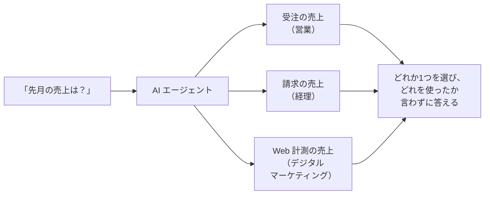
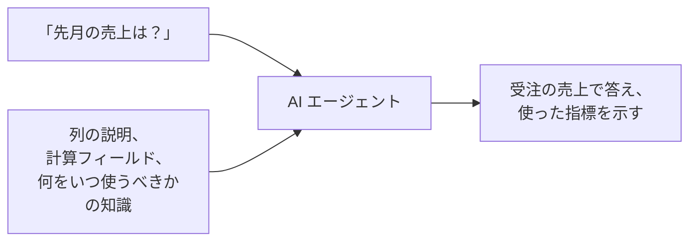
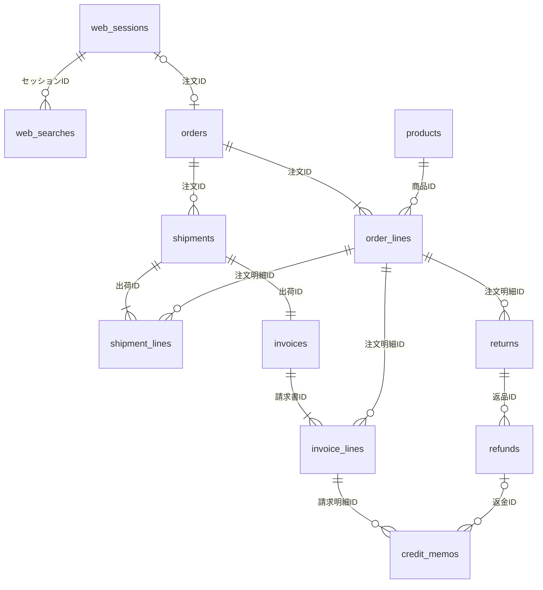
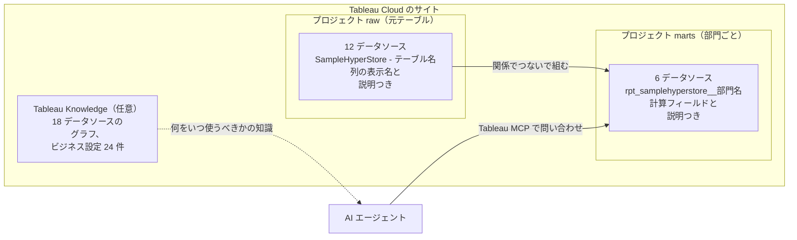

# SampleHyperStore（日本語版）

Tableau MCP でつないだ AI エージェントが、業務の問いに正しい指標で答えられるかを試すためのサンプルデータです。架空の米国小売企業の3年分の取引を、Claude Code で生成しました。会社・人物・数値はすべて架空です。

**[どんな分析ができるかを見る →](https://yoshitakaarakawa.github.io/SampleHyperStore/?lang=ja)** 12 のテーブルとメタデータ・業務ルールの中身、テーブルをまたぐ分析の例、業務ルールで AI の答えが変わる例、デモに使える問いの例を 1 ページで紹介しています。

## なぜこのデータセットか

Tableau の定番のサンプルデータ Superstore は、売上や利益の列があらかじめそろった1つのテーブルです。実際の業務データはそうではありません。システムごとに分かれ、同じ言葉が部門によって違う意味を持ち、指標は自分たちで定義する必要があります。

このようなデータに AI エージェントをそのままつなぐと、どの指標を使えばよいかを AI が選べません。たとえば「先月の売上は？」と尋ねると、次のようになります。

データに説明を付け、指標の意味を定義しておくと、AI は質問に合った指標を選べるようになります。SampleHyperStore では、そのために次の3つを用意しています。

| 足すもの | 中身 | 例 |
|---|---|---|
| 列の説明 | 各列が何を表すか | `キャンセル数量`: 出荷前にキャンセルされた数量 |
| 計算フィールド | 部門ごとの指標の式と説明 | 営業の `売上`: キャンセルを除いた受注売上。注文日で集計する |
| ビジネス設定（Tableau Knowledge） | 言葉の既定の意味と、使い分けのルール | 修飾のない「売上」は受注ベース。会計期間や返品に触れた質問では請求ベース |

SampleHyperStore では、整えていない状態と整えた状態を、同じデータで比べられます。

## AI がつまずきやすい点

このデータには、AI がつまずきやすい状況を意図して入れています。どれも、セットアップで足す説明・計算フィールド・ビジネス設定で解ける想定です。

| つまずきやすい点 | データの中の仕掛け | 解く手がかり |
|---|---|---|
| 同じ名前の指標を取り違える | 「売上」が部門ごとに3通りある | 部門ごとの `売上` の計算フィールドと、ビジネス設定「売上の既定の意味」 |
| 複数ある定義から選べない | 返品率が、申請ベース・受領ベース・注文コホートなど、部門ごとに複数ある | 定義ごとの式を書いたビジネス設定、ビジネス設定「部門ごとに違う指標を指す言葉」と「使い分け: 返品率」 |
| 暦の年と会計年度を混同する | 会計年度が2月に始まる | `会計月` の列の説明と、ビジネス設定「経理の質問での会計期間」 |
| 途中の変化を見落とす | 2025年1月に営業地域が再編されている | 計算フィールド `営業地域（現行の区割り）` と、それをいつ使うかを書いたビジネス設定「営業地域の再編」 |
| データソースをまたぐ指標を組めない | 返品率や純送料コストは、分子と分母が別のデータソースにある | 分子と分母の出どころを書いたビジネス設定 |

問いの一覧は [`docs/questions.md`](docs/questions.md) にあります。比べ方は2通りです。1つは、元テーブルのデータソースだけを AI に見せて尋ねる方法です。もう1つは、指標を定義したデータソースと Tableau Knowledge の設定を加えてから、同じ問いを尋ねる方法です。

## 中身

| 場所 | 内容 |
|---|---|
| `csv/in_use/` | Tableau のセットアップで使う 12 テーブル |
| `csv/planned/` | 今は使っていない 12 テーブル（今後の拡張で使う予定） |
| `docs/data_dictionary.md` | テーブル、粒度、キー、列の説明 |
| `docs/questions.md` | AI エージェントに尋ねる業務の問い |
| `setup/metadata/` | Tableau に載せるときの列の説明、計算フィールド、Tableau Knowledge のビジネス設定 |

対象期間は 2023-01-01 から 2025-12-31 です。屋外用品とホーム＆ガーデン用品を、Web ストア・アプリ・マーケットプレイス・法人取引で売る米国の小売企業を想定しています。

`csv/in_use/` の 12 テーブルは次のようにつながっています。線のラベルはつなぐキーです。

## 使い方

セットアップが終わると、Tableau Cloud のサイトは次のようになります。

部門ごとのデータソースは、billing（請求）、sales_orders（受注）、merchandising（商品）、shipments（出荷）、returns_refunds（返品・返金）、web_analytics（Web 計測）の6つです。

### AI エージェントでセットアップする

Tableau MCP をつないだ AI エージェント（Claude Code など）でこのリポジトリを開き、次のように伝えてください。

> `en/setup/SETUP_FOR_AI.md` を読んで、SampleHyperStore の日本語版を私の Tableau Cloud サイトにセットアップして。

手順書は英語です。AI は Tableau に書き込む前に、毎回あなたに確認します。AI だけでは終わらず、途中で Tableau の Web エディターを操作する手作業があります。AI エージェントが computer use で Tableau Cloud のサイトを操作できるなら、この作業の一部を任せられます。ただし、関係の線の一部は人が引きます。サインインはブラウザでの OAuth で行います。`.env` に書くのはサーバーとサイト名だけで、トークンやパスワードをファイルに置く必要はありません。前提条件は [`SETUP_FOR_AI.md`](../en/setup/SETUP_FOR_AI.md) を参照してください。

### 手でセットアップする

Tableau MCP を使わない場合は、[`docs/setup_manual.md`](docs/setup_manual.md) の手順に沿って進めてください。

## ライセンス

データと文書（CSV、メタデータ、README、`docs/`）は CC BY 4.0 です。

- できること: 複製、再配布、改変、商用での利用
- 条件: 公開や配布をするときに、クレジットを書くこと（作者名、ライセンス名、改変したかどうか）
- クレジットの例: `"SampleHyperStore" by Yoshitaka Arakawa, CC BY 4.0`

コード（`en/setup/scripts/` のスクリプトと、作者用のツール `tools/`）は MIT です。

- できること: 使用、複製、改変、再配布、販売を含む商用での利用
- 条件: コードを配るときに、著作権表示とライセンス文（ルートの [`LICENSE`](../LICENSE)）を残すこと

どちらも無保証です。手元で使うだけなら、条件はかかりません。詳しくは [`LICENSE-DATA.md`](LICENSE-DATA.md) を参照してください。
