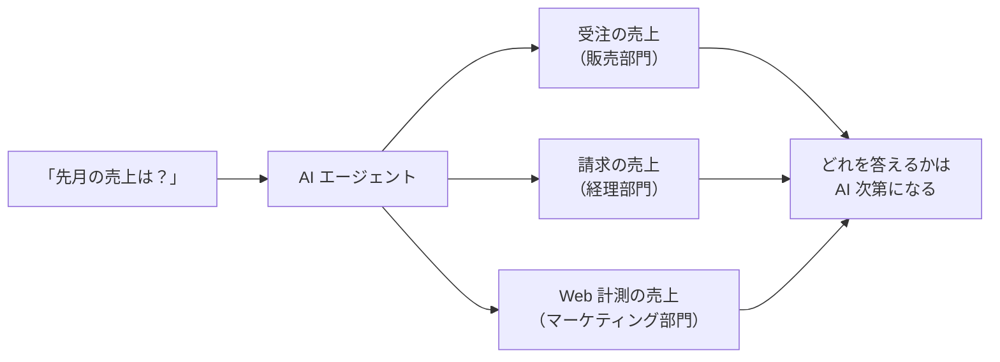
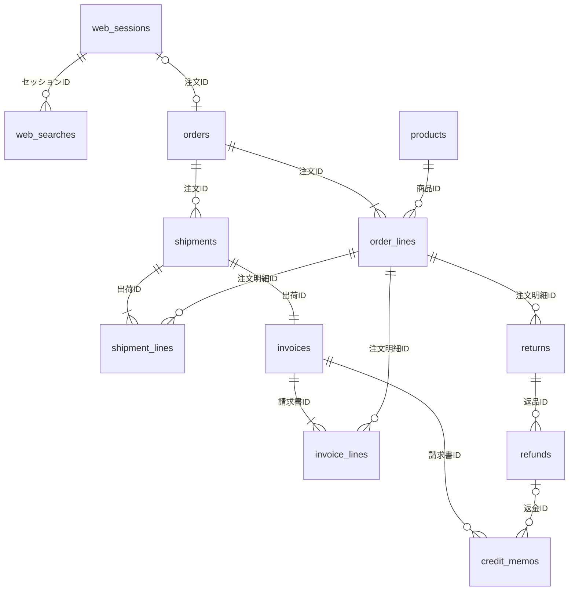

# SampleHyperStore（日本語版）

Claude Code で作成した、架空の小売企業のダミーデータセットです。Tableau で AI によるデータ分析を試すために作りました。会社・人物・数値はすべて架空です。

## なぜこのデータセットか

Tableau の定番のサンプルデータは、売上や利益の列があらかじめそろった、整った1つのテーブルです。実際の業務データはそうではありません。システムごとに分かれ、同じ言葉が部門によって違う意味を持ち、指標は自分たちで定義する必要があります。

このようなデータに AI エージェントをそのままつなぐと、どの指標を使えばよいかを AI が選べません。たとえば「先月の売上は？」と尋ねると、次のようになります。

データに説明を付け、指標の意味を定義しておくと、AI は質問に合った指標を選べるようになります。

SampleHyperStore は、この「整えていない状態」と「整えた状態」を同じデータで比べられるように作っています。

## このデータセットで試せること

| 試せること | データの中にある状況 |
|---|---|
| 同じ言葉の指標を使い分けられるか | 「売上」が部門ごとに3通りある |
| 定義が複数ある指標を選べるか | 返品率に、申請ベース・受領ベースなど複数の定義がある |
| 業務の暦に合わせられるか | 会計年度が2月に始まる |
| 途中の変化に気づけるか | 2025年1月に営業地域が再編されている |
| 複数の部門のデータをつなげるか | 注文・出荷・請求・返品・Web のデータがキーでつながっている |

問いの一覧は [`docs/questions.md`](docs/questions.md) にあります。セットアップの前と後で同じ問いを AI に尋ね、答えを比べてください。

## 中身

| 場所 | 内容 |
|---|---|
| `csv/in_use/` | Tableau のセットアップで使う 12 テーブル。 |
| `csv/planned/` | 今は使っていない 12 テーブル。今後の拡張で使う予定です。 |
| `docs/data_dictionary.md` | テーブル、粒度、キー、列の説明。 |
| `docs/questions.md` | AI エージェントに尋ねる業務の問い。 |
| `setup/metadata/` | Tableau に載せるときの列の説明、計算フィールド、Tableau Knowledge のビジネス設定。 |

対象期間は 2023-01-01 から 2025-12-31 です。屋外用品とホーム＆ガーデン用品を、Web ストア・アプリ・マーケットプレイス・法人取引で売る米国の小売企業を想定しています。

`csv/in_use/` の 12 テーブルは次のようにつながっています。線のラベルはつなぐキーです。

## 使い方

### AI エージェントでセットアップする

Tableau MCP をつないだ AI エージェント（Claude Code など）でこのリポジトリを開き、次のように伝えてください。

> `en/setup/SETUP_FOR_AI.md` を読んで、SampleHyperStore の日本語版を私の Tableau Cloud サイトにセットアップして。

手順の詳細と前提条件は [`SETUP_FOR_AI.md`](../en/setup/SETUP_FOR_AI.md) にあります。

### 手でセットアップする

Tableau MCP を使わない場合は、[`docs/setup_manual.md`](docs/setup_manual.md) の手順に沿って進めてください。

## ライセンス

データと文書は CC BY 4.0、コードは MIT です。詳しくは [`LICENSE-DATA.md`](LICENSE-DATA.md) を参照してください。
